# ARCHITECTURE DIAGRAMS - ERP Creative

> Visual diagrams to help AI understand the system architecture

---

## 1. System Architecture

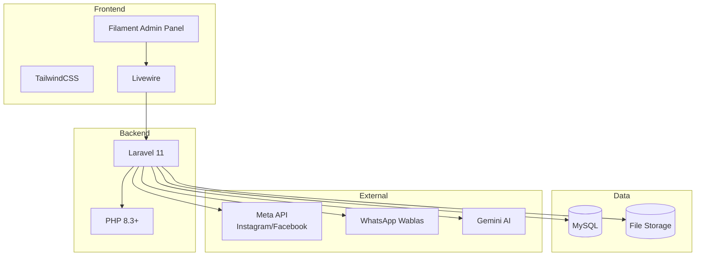

---

## 2. Data Flow - Lead to Contract

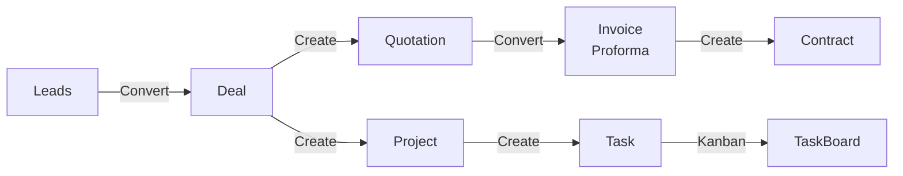

---

## 3. Finance Flow

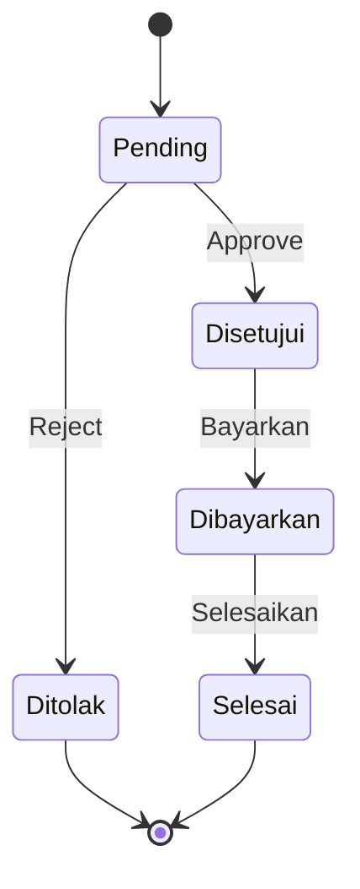

---

## 4. Entity Relationships

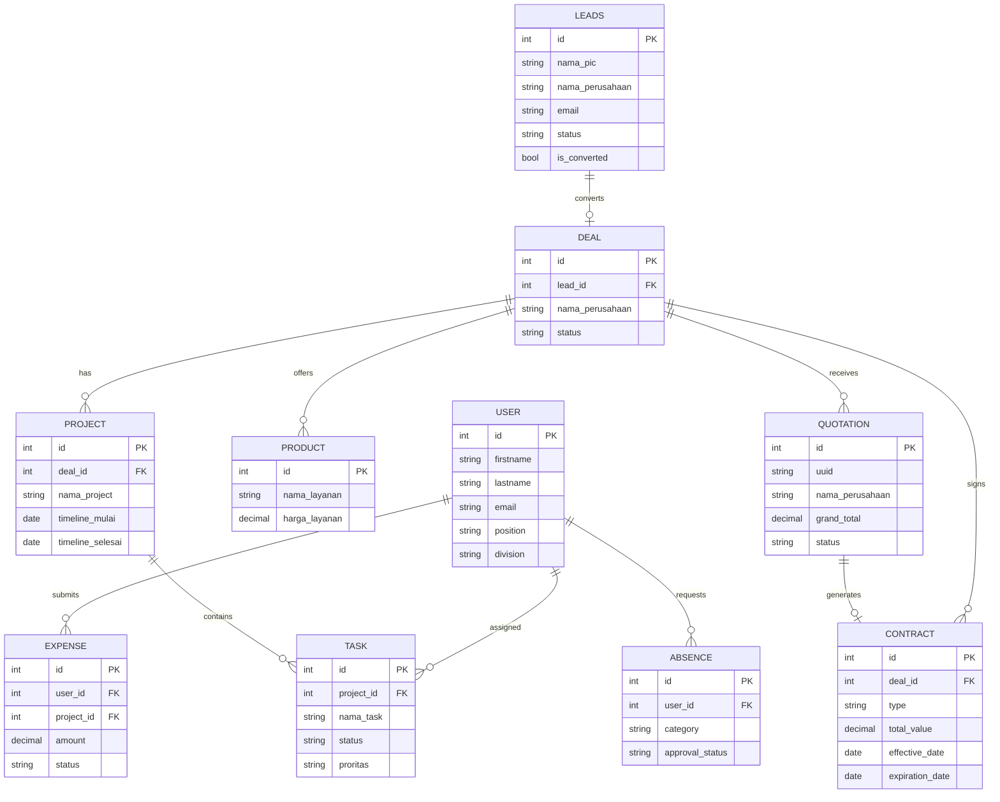

---

## 5. Navigation Structure

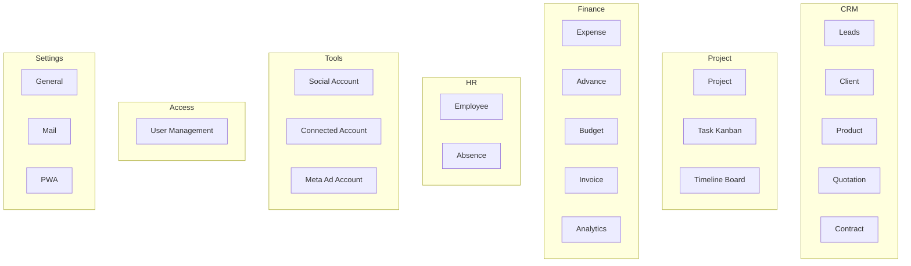

---

## 6. User Permissions Matrix

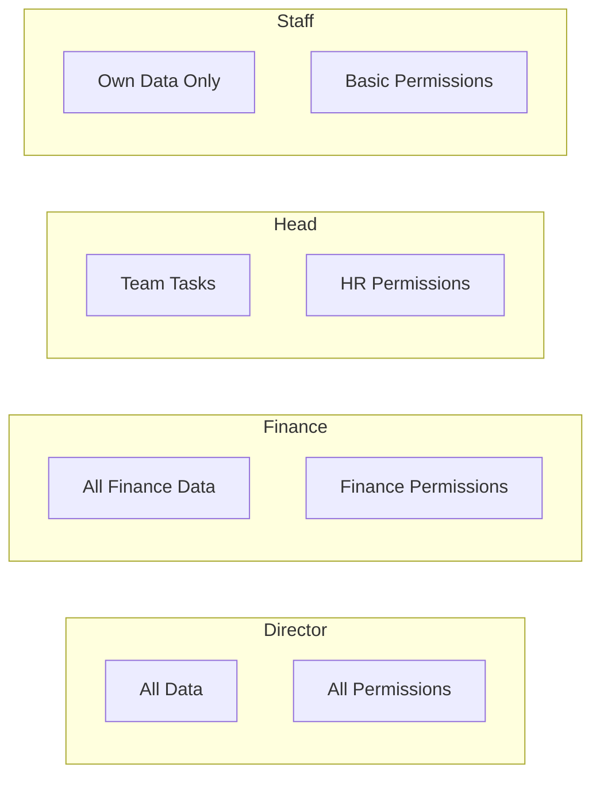

---

## 7. Task Workflow

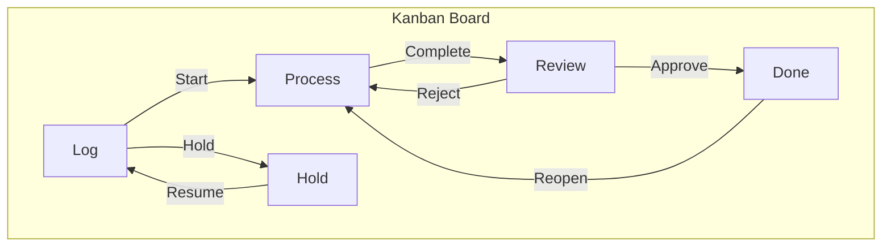

---

## 8. API Flow

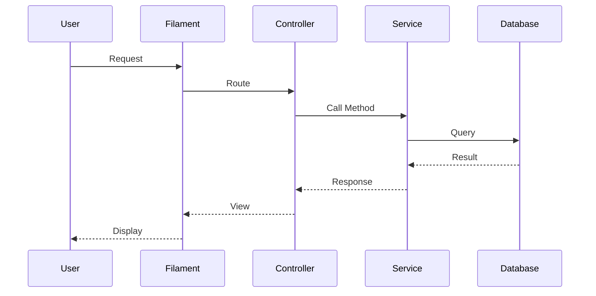

---

## 9. Key Services Architecture

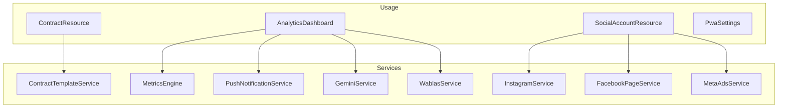

---

## 10. Database Schema Overview

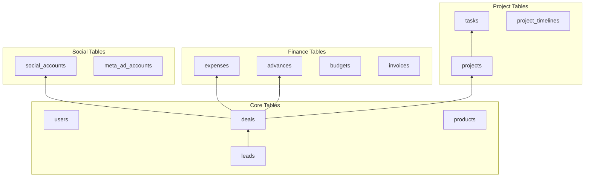

---

## 11. Settings Schema

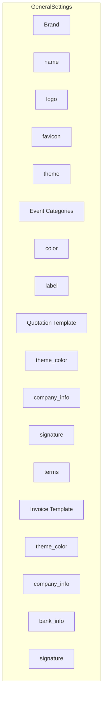

---

**End of Architecture Diagrams**